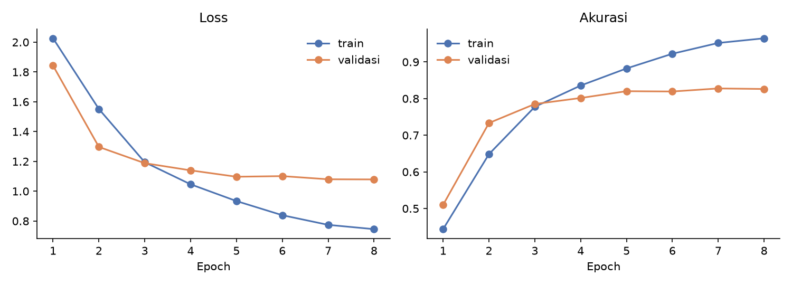
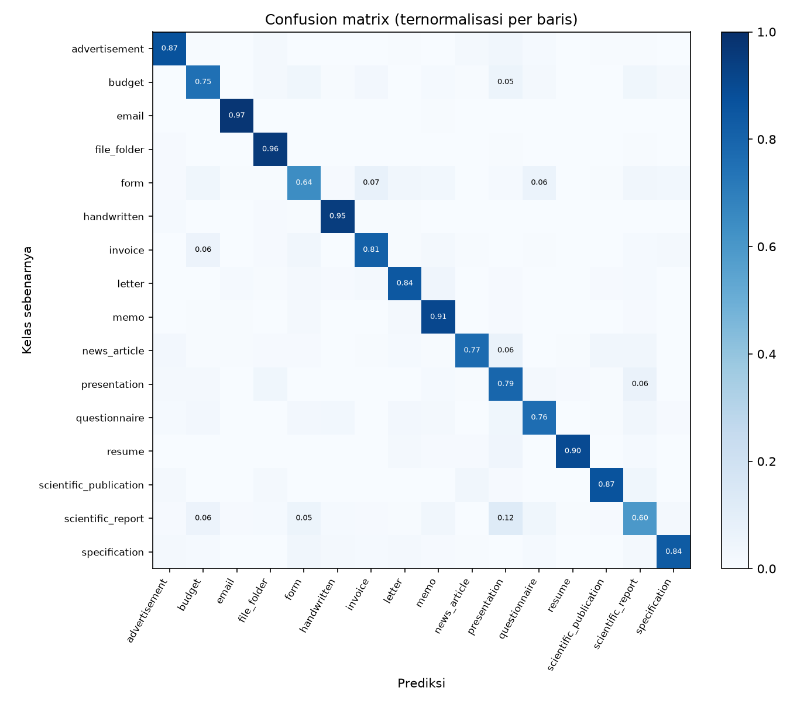

# Klasifikasi Dokumen Hasil Scan dengan PyTorch

Tugas 2 Supervised Machine Learning. Membangun model neural network untuk mengklasifikasikan halaman dokumen hasil scan ke 16 kategori dokumen bisnis, dengan transfer learning ResNet18 yang dilatih sepenuhnya di CPU.

Kompetisi: https://www.kaggle.com/competitions/document-image-classification-sd234504

| Ringkasan hasil | |
|---|---|
| Model | ResNet18 pretrained ImageNet, input 160 x 160 grayscale |
| Akurasi validasi (4.801 gambar) | 0,8277 |
| Public score Kaggle | 0,83228 |
| Private score | diisi setelah kompetisi ditutup |
| Waktu training | sekitar 2,8 jam (8 epoch, CPU Core i5-1235U, tanpa GPU) |

## Struktur Repository

```
doc-image-classification/
  README.md
  .gitignore
  requirements.txt
  data/                      (di-ignore git) CSV, gambar, dan cache hasil resize
  notebooks/
    01_eda.ipynb             EDA dan pemilihan resolusi
    02_modeling.ipynb        split, training, evaluasi, analisis error
    03_submission.ipynb      verifikasi model final, prediksi test, sanity check
  scripts/
    __init__.py
    config.py                konfigurasi, path, konstanta kelas
    utils.py                 seed, device, validasi data
    preprocess.py            cache gambar (grayscale, resize) dan transform
    dataset.py               Dataset, split stratified, DataLoader
    model.py                 arsitektur, beku/buka backbone, simpan/muat checkpoint
    train.py                 training dua tahap dan benchmark kecepatan
    evaluate.py              confusion matrix, laporan per kelas, pasangan tertukar
    predict.py               inferensi dan pembuatan submission
  checkpoint/                (di-ignore git) bobot model dan riwayat training
  submissions/               submission.csv
  reports/
    results_resnet18_160.md  ringkasan hasil evaluasi (dibuat otomatis)
    figures/                 gambar untuk laporan
```

Setiap function dan class pada file `.py` memiliki docstring.

## Setup

Diuji dengan Python 3.11 di Windows. Instalasi `pip` biasa di Windows menghasilkan PyTorch versi CPU, yang cukup untuk repo ini.

```bash
git clone <url-repo-ini>
cd doc-image-classification
python -m venv .venv
.venv\Scripts\activate           # macOS/Linux: source .venv/bin/activate
pip install -r requirements.txt
```

## Cara Mengunduh Data

Dataset tidak disimpan di repository (aturan ukuran dan `.gitignore`).

1. Buat API token Kaggle (Settings > API > Create New Token), simpan `kaggle.json` di `~/.kaggle/` (Windows: `C:\Users\<nama>\.kaggle\`).
2. Gabung kompetisi lewat browser (terima rules), lalu dari root repo:

```bash
kaggle competitions download -c document-image-classification-sd234504 -p data/
```

3. Ekstrak sehingga susunannya seperti ini (perhatikan tidak ada folder `train/train/`):

```
data/
  train.csv  test.csv  sample_submission.csv
  train/<nama_kelas>/*.tif
  test/*.tif
```

Windows (PowerShell): `Expand-Archive data\train.zip -DestinationPath data`, dan hal yang sama untuk `test.zip`. Lokasi data dapat diubah lewat environment variable `DOC_DATA_DIR`.

4. Verifikasi:

```bash
python -c "from scripts.config import Config; from scripts.utils import verify_data_layout; print(verify_data_layout(Config()))"
```

Output yang benar: `n_train: 32003, n_test: 7994, n_classes: 16`.

## Cara Menjalankan (Reproduksi)

Seluruh pipeline berjalan di CPU. Jalankan dari root repo.

```bash
# 1. Cache gambar ter-resize (sekali saja)
python -m scripts.preprocess --size 160 --workers 4

# 2. Estimasi waktu per epoch, lalu smoke test
python -m scripts.train --benchmark --threads 8
python -m scripts.train --subset 2000 --epochs 2 --threads 8

# 3. Training penuh (sekitar 2,8 jam)
python -m scripts.train --model resnet18 --epochs 8 --freeze-epochs 1 --threads 8

# 4. Evaluasi pada validasi (confusion matrix, laporan per kelas)
python -m scripts.evaluate --checkpoint checkpoint/resnet18_160_best.pt

# 5. Submission
python -m scripts.predict --checkpoints checkpoint/resnet18_160_best.pt
```

Smoke test (langkah 2) menyimpan checkpoint dengan nama yang sama dengan training penuh, jadi jalankan sebelum langkah 3.

Urutan notebook: `01_eda`, `02_modeling`, `03_submission`. Notebook 02 memiliki sakelar `RUN_TRAINING` (default `False`) untuk melatih ulang dari notebook; secara default notebook memakai checkpoint dan riwayat yang sudah tersimpan.

## Metodologi

**Preprocessing.** Setiap gambar (grayscale, tinggi 1.000 piksel, lebar rata-rata 766) di-resize ke 160 x 160 piksel dengan anti-aliasing dan disimpan sebagai array uint8 (cache). Decoding TIF besar dilakukan sekali sehingga setiap epoch hanya membaca array kecil. Untuk input model, satu channel diulang tiga kali agar kompatibel dengan bobot pretrained, lalu dinormalisasi.

**Augmentasi** (hanya data latih): rotasi hingga 2 derajat, geser hingga 2 persen, dan skala 0,97 sampai 1,03. Tanpa flip horizontal karena teks terbalik tidak pernah muncul pada data uji.

**Model.** ResNet18 pretrained ImageNet dengan head baru (dropout 0,2 dan layer linear 16 kelas), 11,18 juta parameter. Kode juga mendukung MobileNetV3 small dan large, tetapi keduanya tidak dilatih pada pengumpulan ini karena keterbatasan waktu dan komputasi.

**Training dua tahap.** Epoch 1: backbone dibekukan (BatchNorm dikunci) dan hanya head yang dilatih. Epoch 2 sampai 8: seluruh jaringan di-fine-tune dengan learning rate backbone 10 kali lebih kecil daripada head dan jadwal cosine. Optimizer AdamW (lr 1e-3, weight decay 1e-4), loss cross-entropy dengan label smoothing 0,1, batch 64, early stopping berdasarkan akurasi validasi dengan patience 3. Checkpoint terbaik disimpan setiap akurasi validasi membaik.

**Validasi.** Split stratified 85/15 dengan seed 42 (27.202 latih dan 4.801 validasi). Indeks validasi disimpan di dalam checkpoint agar evaluasi selalu memakai split yang sama.

**Asumsi dan keterbatasan metode.**
- Split acak mengasumsikan tidak ada dokumen hampir-duplikat lintas split. Public score yang dekat dengan akurasi validasi tidak menunjukkan indikasi masalah ini, tetapi belum membuktikannya.
- Resize ke persegi mengubah aspect ratio (0,77 menjadi 1,0). Distorsinya konsisten pada semua gambar karena rasio aslinya sangat seragam (simpangan baku 0,02).
- Pada 160 piksel teks tidak terbaca; model mengandalkan tata letak, bukan isi dokumen.
- Kelas seimbang (rasio terbesar terhadap terkecil 1,055), sehingga akurasi cukup sebagai metrik utama.

## Hasil Eksperimen

| Eksperimen | Model | Input | Epoch | Val acc | Public score |
|---|---|---|---|---|---|
| Final | resnet18 | 160 | 8 (terbaik: epoch 7) | 0,8277 | 0,83228 |

Private score: diisi setelah kompetisi ditutup.

Riwayat training (loss validasi memakai label smoothing 0,1 sehingga tidak sebanding dengan cross-entropy biasa):

| Epoch | Train loss | Train acc | Val loss | Val acc | Detik |
|---|---|---|---|---|---|
| 1 (head saja) | 2,0260 | 0,4437 | 1,8424 | 0,5101 | 787 |
| 2 | 1,5514 | 0,6484 | 1,2969 | 0,7334 | 1458 |
| 3 | 1,1944 | 0,7776 | 1,1882 | 0,7853 | 1388 |
| 4 | 1,0464 | 0,8357 | 1,1400 | 0,8017 | 1313 |
| 5 | 0,9340 | 0,8823 | 1,0972 | 0,8202 | 1311 |
| 6 | 0,8391 | 0,9225 | 1,1014 | 0,8194 | 1311 |
| 7 | 0,7744 | 0,9519 | 1,0801 | 0,8277 | 1308 |
| 8 | 0,7456 | 0,9646 | 1,0792 | 0,8263 | 1327 |



Hasil per kelas pada data validasi:

| Kelas | Precision | Recall | F1 | Jumlah |
|---|---|---|---|---|
| advertisement | 0,859 | 0,871 | 0,865 | 302 |
| budget | 0,756 | 0,751 | 0,753 | 301 |
| email | 0,945 | 0,974 | 0,959 | 302 |
| file_folder | 0,856 | 0,960 | 0,905 | 303 |
| form | 0,724 | 0,645 | 0,682 | 301 |
| handwritten | 0,909 | 0,947 | 0,928 | 304 |
| invoice | 0,823 | 0,815 | 0,819 | 297 |
| letter | 0,833 | 0,845 | 0,839 | 296 |
| memo | 0,814 | 0,910 | 0,859 | 299 |
| news_article | 0,880 | 0,770 | 0,822 | 296 |
| presentation | 0,657 | 0,789 | 0,717 | 299 |
| questionnaire | 0,802 | 0,764 | 0,782 | 292 |
| resume | 0,955 | 0,898 | 0,925 | 304 |
| scientific_publication | 0,918 | 0,867 | 0,891 | 308 |
| scientific_report | 0,651 | 0,597 | 0,623 | 300 |
| specification | 0,873 | 0,835 | 0,854 | 297 |

Akurasi 0,828 dan macro F1 0,827 pada 4.801 sampel.



Sepuluh pasangan kesalahan terbanyak:

| Kelas benar | Diprediksi | Jumlah | Proporsi kelas benar |
|---|---|---|---|
| scientific_report | presentation | 37 | 0,123 |
| form | invoice | 22 | 0,073 |
| news_article | presentation | 19 | 0,064 |
| presentation | scientific_report | 19 | 0,064 |
| form | questionnaire | 18 | 0,060 |
| scientific_report | budget | 17 | 0,057 |
| invoice | budget | 17 | 0,057 |
| budget | presentation | 16 | 0,053 |
| scientific_report | form | 16 | 0,053 |
| resume | presentation | 13 | 0,043 |

## Laporan Interpretasi

**1. Performa umum.** ResNet18 mencapai akurasi validasi 0,8277 dan public score 0,83228, sekitar 13 kali tebakan acak (0,0625). Selisih validasi dan public score sekitar 0,5 poin, masih dalam rentang noise statistik (galat standar akurasi pada ribuan sampel sekitar 0,5 poin), sehingga validasi lokal merupakan estimasi yang cukup andal. Private score diperkirakan sekitar 0,83 dengan ketidakpastian sekitar satu poin; ini perkiraan, bukan jaminan.

**2. Dinamika training.** Pada epoch 1 hanya head yang dilatih (akurasi validasi 0,510). Setelah backbone dibuka pada epoch 2, akurasi validasi melonjak ke 0,733, yang menunjukkan fitur ImageNet saja tidak cukup untuk dokumen dan fine-tuning penuh diperlukan. Akurasi validasi naik sampai epoch 4, lalu mendatar di kisaran 0,82 sampai 0,83 (puncak 0,8277 pada epoch 7; selisih antar epoch tersebut masih dalam noise). Akurasi train terus naik sampai 0,965, sehingga model overfitting dengan kesenjangan sekitar 14 poin, dan loss validasi berhenti turun sekitar epoch 5. Menambah epoch tidak akan membantu; perbaikan perlu datang dari regularisasi, data, atau resolusi.

**3. Kelas terkuat dan terlemah.** Kelas dengan pola visual khas paling mudah: email (F1 0,959), handwritten (0,928), resume (0,925), dan file_folder (0,905). Kelas terlemah adalah scientific_report (F1 0,623), form (0,682), presentation (0,717), dan budget (0,753). Dengan sekitar 300 sampel validasi per kelas, recall per kelas memiliki ketidakpastian sekitar 4 poin, sehingga kelas di tengah (F1 sekitar 0,82 sampai 0,86) tidak bisa dibedakan secara meyakinkan. Presentation berperan sebagai kelas penampung: recall 0,789 tetapi precision hanya 0,657, karena banyak dokumen kelas lain diprediksi sebagai presentation (dari scientific_report, news_article, budget, dan resume).

**4. Analisis error.** Kesalahan terbesar adalah scientific_report yang diprediksi presentation (37 kasus, 12,3 persen dari kelasnya). Dari 8 contoh acak pasangan ini (`reports/figures/top_confusion_examples.png`), satu halaman terotasi 90 derajat, lima halaman jarang teks (tabel hasil dengan banyak ruang putih, halaman sampul bertanda tangan, halaman judul makalah, halaman proposal yang hampir kosong, dan daftar poin bernomor yang memang menyerupai slide agenda), dan dua halaman teks padat biasa. Ini menunjukkan scientific_report adalah kelas yang heterogen, dan pada 160 piksel sebagian halamannya sulit dibedakan dari slide. Dugaan bahwa rotasi menjadi penyebab dominan tidak didukung (1 dari 8). Pasangan lain terkumpul pada dokumen berbentuk tabel dan kotak (form, invoice, budget, questionnaire). Pada 8 contoh kesalahan acak (`reports/figures/misclassified_examples.png`), sebagian dokumen memang bercampur ciri dua kelas (misalnya questionnaire dengan komentar tulisan tangan dan letter yang tampak seperti halaman makalah) atau berkualitas scan buruk, sehingga sebagian error adalah batas atas yang sulit dicapai model. Karena sampelnya kecil, semua ini adalah pola yang tampak, bukan proporsi.

**5. Hipotesis EDA yang tidak terbukti.** Pada EDA saya menduga letter, memo, dan email paling sering tertukar karena tata letaknya mirip. Hasil evaluasi tidak mendukung dugaan itu: ketiganya memiliki F1 0,84 sampai 0,96 dan tidak muncul di sepuluh besar pasangan kesalahan. Pasangan scientific_publication dan scientific_report juga tidak masuk sepuluh besar.

**6. Sanity check data uji.** Proporsi prediksi pada data uji mendekati proporsi data latih; selisih terbesar hanya 0,0064 (file_folder), dan tidak ada kelas yang hilang atau mendominasi. Arah penyimpangan sebagian besar sejalan dengan pola precision dan recall di validasi, tetapi selisihnya mendekati noise sehingga tidak ditafsirkan lebih jauh. Proporsi data uji sebenarnya tidak diketahui, jadi perbandingan ini hanya acuan.

**7. Keterbatasan dan langkah lanjut.**
- Hanya satu arsitektur yang dilatih. Perbandingan dengan model lain (misalnya MobileNetV3, yang sudah didukung kode) dan ensemble tidak dilakukan karena keterbatasan waktu dan komputasi CPU.
- Resolusi 160 piksel membuang teks. Resolusi yang lebih tinggi atau fitur teks (OCR) berpotensi membantu kelas yang pembedanya adalah isi, tetapi belum diuji dan membutuhkan biaya komputasi lebih besar.
- Overfitting yang jelas membuka ruang untuk regularisasi (augmentasi lebih kuat, weight decay lebih besar, dropout), yang belum dieksplorasi.
- Analisis error mengandalkan sampel kecil (8 contoh per sel) dan belum mengukur seberapa besar label ambigu berkontribusi pada error.

**Implikasi praktis.** Sistem ini layak sebagai penyortir otomatis tahap pertama, dengan peninjauan manusia pada kelas berisiko error tinggi (scientific_report, form, presentation), bukan sebagai keputusan final tanpa pengawasan.

## Pemenuhan Ketentuan Tugas

| Ketentuan | Pemenuhan |
|---|---|
| Menggunakan PyTorch, berbasis neural network | ResNet18 pretrained, fine-tuning di PyTorch |
| Jangan commit dataset besar, `.gitignore` untuk `data/` dan `checkpoint/` | Keduanya di `.gitignore` |
| Cara unduh data didokumentasikan | Bagian "Cara Mengunduh Data" |
| Docstring pada setiap function dan class | Seluruh file di `scripts/` |
| Tree structure dan workflow analisis | Bagian "Struktur Repository", tiga notebook berurutan |
| Cara penggunaan repository dan laporan interpretasi | Bagian "Cara Menjalankan" dan "Laporan Interpretasi" |
